### MAI in Computer Engineering at Trinity College Dublin. I build things that run autonomously and get measured against something real.

- 🔭 I'm currently building **Pagerless, an AI on-call engineer: when an alert fires, it investigates metrics, traces and logs and writes a root-cause report that cites its evidence**

- 🌱 I'm currently **working toward an AWS certification**

- 💬 Ask me about **AWS serverless, applied ML on real operational data, and mixed reality on Quest 3**

- 📫 How to reach me **guptakartik30304@gmail.com**

- ⚡ Fun fact **I plan my training like an RPG stat sheet and have been reliably informed that bodies do not work that way**

<h3 align="left">Connect with me:</h3>

<h3 align="left">Languages and Tools:</h3>
<table>
<tr><td align="right"><b>Languages</b></td><td>

</td></tr>
<tr><td align="right"><b>ML &amp; Data</b></td><td>

</td></tr>
<tr><td align="right"><b>Cloud &amp; Databases</b></td><td>

</td></tr>
<tr><td align="right"><b>XR, 3D &amp; Hardware</b></td><td>

</td></tr>
<tr><td align="right"><b>Tools</b></td><td>

</td></tr>
</table>

<picture>
<source media="(prefers-color-scheme: dark)" srcset="https://raw.githubusercontent.com/XxAG17xX/XxAG17xX/output/snake-neon.svg" />

</picture>

<!-- SPACE:START -->
<table>
<tr>
<td width="50%" valign="top" align="center">

  
<b>Earth, 2 days ago</b>
 
Full-disc Earth from DSCOVR, 1.44 million km out. 2 frames from 2026-11-16; the latest is centred on 14°S 100°E.
  
<i>NASA EPIC aboard DSCOVR, 2026-11-16</i>
</td>
<td width="50%" valign="top" align="center">

  
<b>Device for Lowering Mars Science Laboratory Rover to the Surface</b>
 
This is hardware for controlling the final lowering of NASA Mars Science Laboratory rover to the surface of Mars from the spacecraft hovering...
  
<i>NASA Image Library, &quot;mars surface&quot;</i>
</td>
</tr>
</table>

<table>
<tr>
<td width="40%" valign="middle"></td>
<td valign="middle">📰 <b>Today in spaceflight</b>  <b><a href="https://europeanspaceflight.com/pld-space-investor-selects-miura-5-to-launch-demo-mission/">PLD Space Investor Selects MIURA 5 to Launch Demo Mission</a></b>  European Spaceflight, 2026-11-18</td>
</tr>
</table>
<!-- SPACE:END -->

<!-- PICKS:START -->
<table>
<tr>
<td width="25%" valign="top" align="center">

 <b>🎬 ANIME</b>
 <b><a href="https://anilist.co/anime/112151">Demon Slayer -Kimetsu no Yaiba- The...</a></b>
 ⭐ 8.4 · 2020 · 1 ep · Action · Adventure
</td>
<td width="25%" valign="top" align="center">

 <b>📖 MANHWA</b>
 <b><a href="https://anilist.co/manga/130229">Shotgun Boy</a></b>
 ⭐ 7.7 · 2021 · 69 chs · Action · Psychological
</td>
<td width="25%" valign="top" align="center">

 <b>📚 SCIENCE</b>
 <b><a href="https://openlibrary.org/works/OL2950948W">Pale Blue Dot</a></b>
 Carl Sagan · 1994 · ⭐ 9.1
</td>
<td width="25%" valign="top" align="center">

 <b>💬 QUOTE</b>
 <b><a href="assets/daily/quote-2026-11-17.svg">Fang Yuan</a></b>
 Reverend Insanity
</td>
</tr>
</table>
<!-- PICKS:END -->

<!-- © 2026 Kartik Gupta. All rights reserved; see LICENSE. The SPACE and PICKS blocks are machine-written daily. -->
