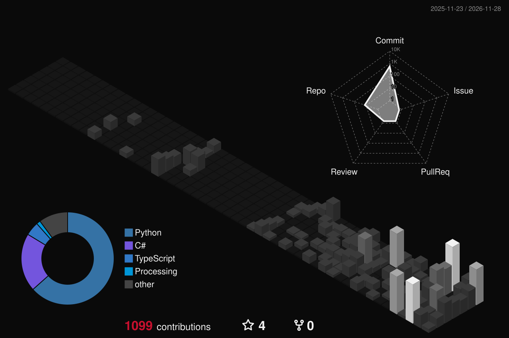

### MAI in Computer Engineering at Trinity College Dublin. I build things that run autonomously and get measured against something real.

- 🔭 I'm currently working on **my MAI thesis: stochastic prediction of train delays on the Irish Rail network**

<!-- LATEST:START -->
- 🛰️ Latest build **<a href="https://github.com/XxAG17xX/pagerless">pagerless</a>**: On-call AI agent: investigates alerts across metrics, traces and logs via MCP and writes a cited root-cause report. 85% correct on 8 injected fault types.
<!-- LATEST:END -->

- 💬 Ask me about **AI agents and MCP, applied ML on live operational data, AWS serverless, and mixed reality on Quest 3**

- 📫 How to reach me **guptakartik30304@gmail.com**

- ⚡ Fun fact **I plan my training like an RPG stat sheet and have been reliably informed that bodies do not work that way**

<h3 align="left">Connect with me:</h3>

<h3 align="left">Languages and Tools:</h3>
<table>
<tr><td align="right"><b>Languages</b></td><td>

</td></tr>
<tr><td align="right"><b>ML &amp; Data</b></td><td>

</td></tr>
<tr><td align="right"><b>Web &amp; Apps</b></td><td>

</td></tr>
<tr><td align="right"><b>Cloud &amp; Ops</b></td><td>

</td></tr>
<tr><td align="right"><b>Databases</b></td><td>

</td></tr>
<tr><td align="right"><b>XR, 3D &amp; Hardware</b></td><td>

</td></tr>
<tr><td align="right"><b>Tools</b></td><td>

</td></tr>
</table>

&nbsp;&nbsp;&nbsp;&nbsp;

<picture>
<source media="(prefers-color-scheme: dark)" srcset="https://raw.githubusercontent.com/XxAG17xX/XxAG17xX/output/snake-noir.svg" />

</picture>

<!-- SPACE:START -->
<table>
<tr>
<td width="50%" valign="top" align="center">

  
<b>Earth, 2 days ago</b>
 
Full-disc Earth from DSCOVR, 1.40 million km out. 4 frames from 2026-11-23; the latest is centred on 18°S 169°W.
  
<i>NASA EPIC aboard DSCOVR, 2026-11-23</i>
</td>
<td width="50%" valign="top" align="center">

  
<b>Supernova Remnant G54</b>
 
This image of supernova remnant G54.1+0.3 includes radio, infrared and X-ray light. The saturated yellow point at the center of the image indicates...
  
<i>NASA Image Library, &quot;supernova remnant&quot;</i>
</td>
</tr>
</table>

<table>
<tr>
<td width="40%" valign="middle"></td>
<td valign="middle">📰 <b>Today in spaceflight</b>  <b><a href="https://www.nasa.gov/centers-and-facilities/goddard/childhood-career-come-full-circle-for-budget-analyst-at-nasa-goddard/">Childhood, Career Come Full Circle for Budget Analyst at NASA Goddard</a></b>  NASA, 2026-11-25</td>
</tr>
</table>
<!-- SPACE:END -->

<!-- PICKS:START -->
<table>
<tr>
<td width="25%" valign="top" align="center">

 <b>🎬 ANIME</b>
 <b><a href="https://anilist.co/anime/21459">My Hero Academia</a></b>
 ⭐ 7.6 · 2016 · 13 eps · Action · Adventure
</td>
<td width="25%" valign="top" align="center">

 <b>📖 MANHUA</b>
 <b><a href="https://anilist.co/manga/170923">Kaiju Qian Dao Huanggu Shengti</a></b>
 ⭐ 6.8 · 2023 · Action
</td>
<td width="25%" valign="top" align="center">

 <b>📚 MINDSET</b>
 <b><a href="https://openlibrary.org/works/OL18108064W">Can&#x27;t Hurt Me</a></b>
 David Goggins · 2018 · ⭐ 8.4
</td>
<td width="25%" valign="top" align="center">

 <b>💬 QUOTE</b>
 <b><a href="assets/daily/quote-2026-11-26.svg">Fang Yuan</a></b>
 Reverend Insanity
</td>
</tr>
</table>
<!-- PICKS:END -->

<!-- © 2026 Kartik Gupta. All rights reserved; see LICENSE. The SPACE and PICKS blocks are machine-written daily. -->
