# Theme rotation preview

One theme per day, in this order. Delete this file after review.

## neon



## f1

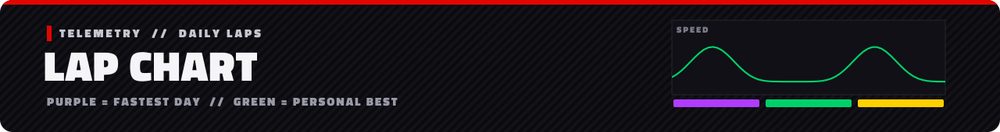
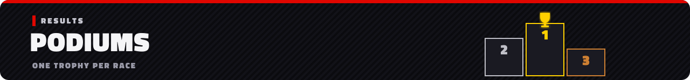
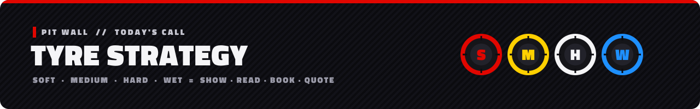
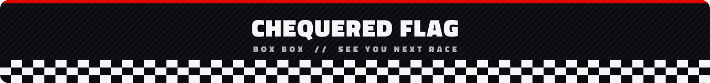

## sumi

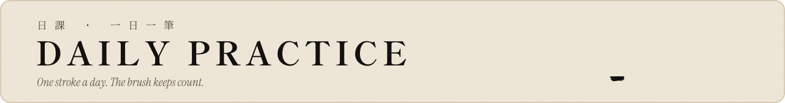

## terminal
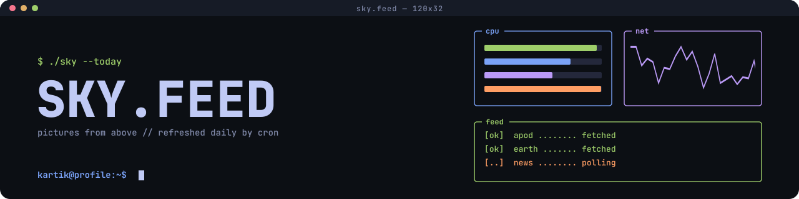

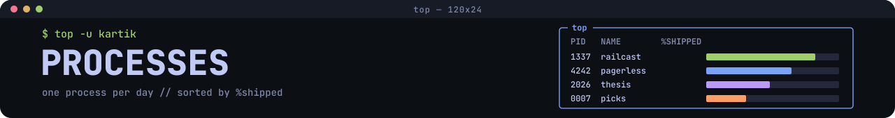
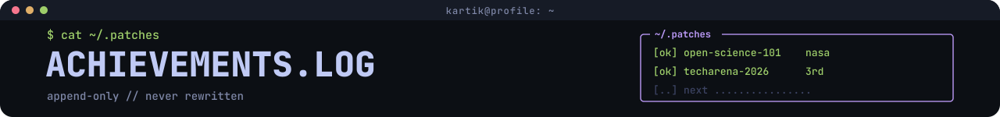
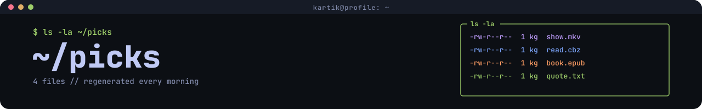
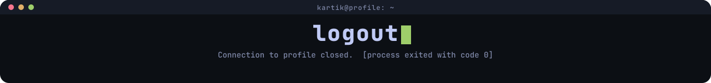

## aurora


## dossier

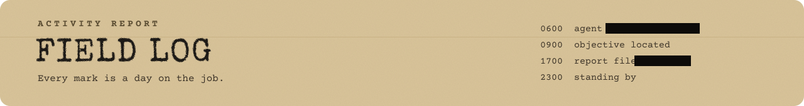


## mission


## hazard
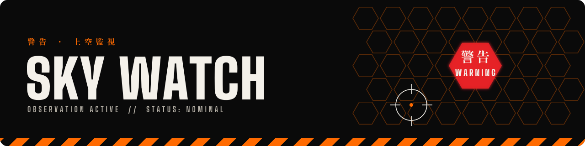

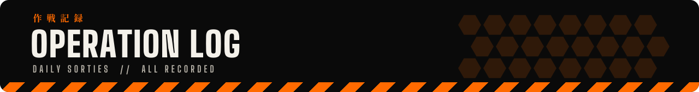
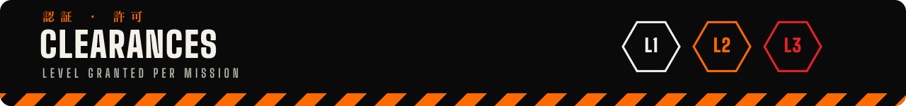
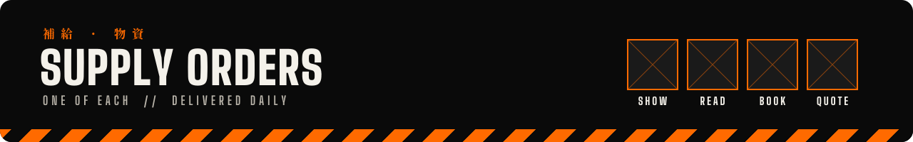
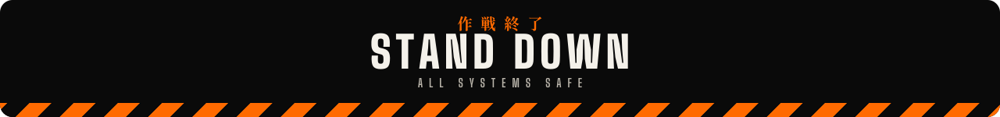

## swiss
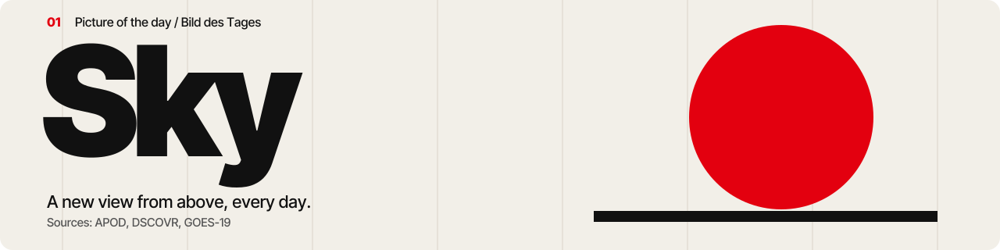

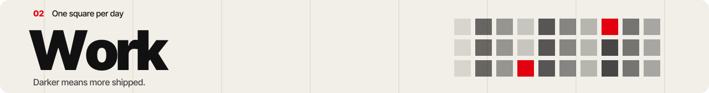
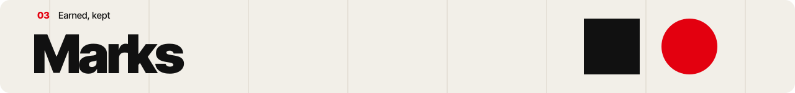
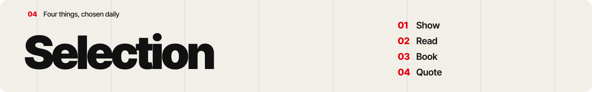

## cockpit
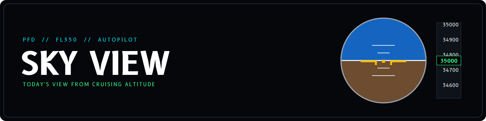

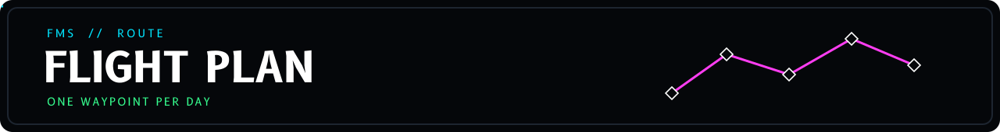

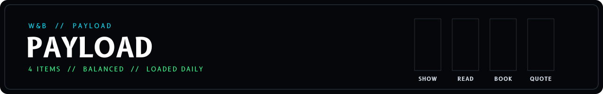
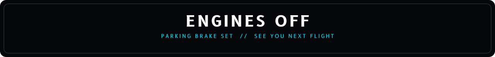

## blueprint
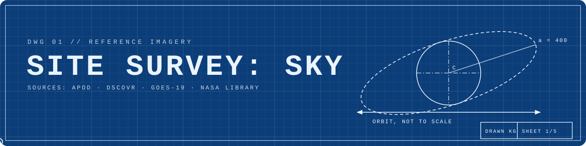

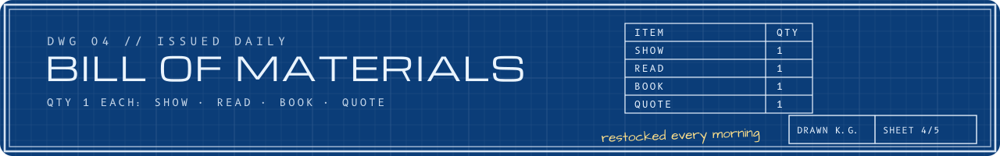

## sonar

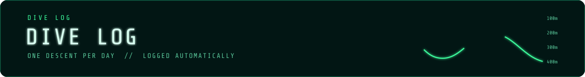
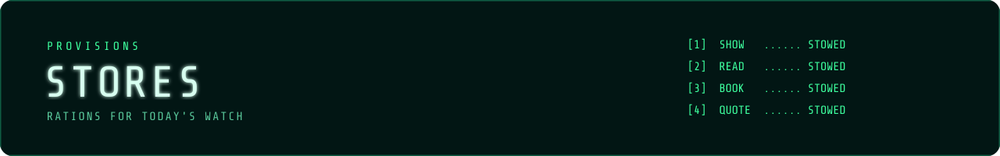

## brass
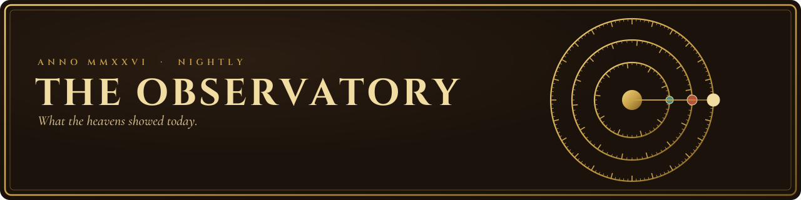

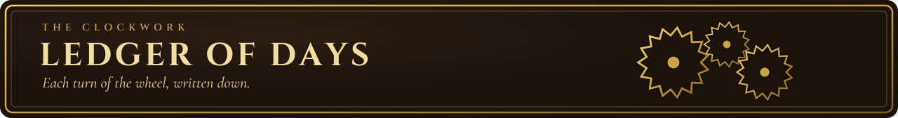
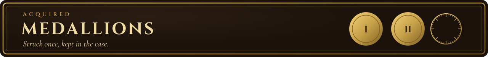
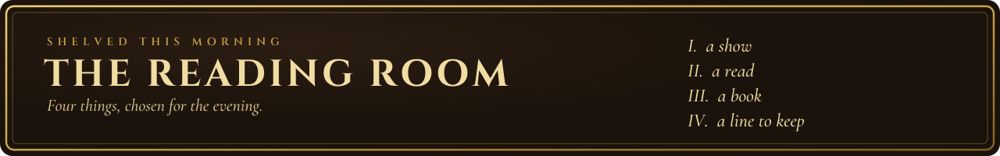
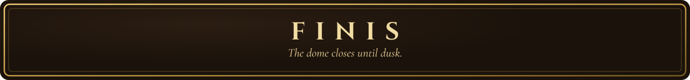

